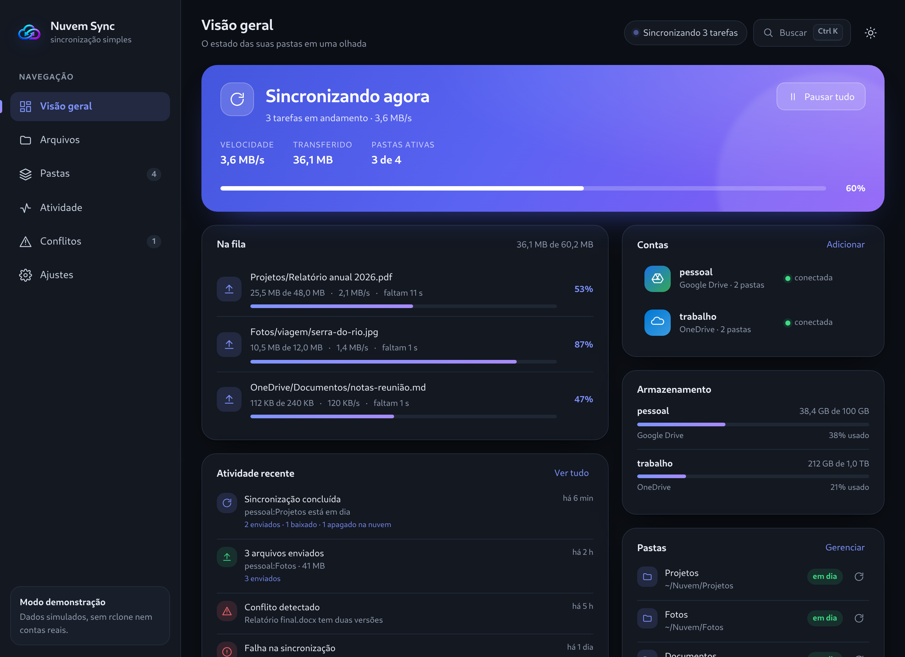

# BrisaSync

Two-way sync between folders on this computer and **Google Drive**, **OneDrive**, **Dropbox**, or **Nextcloud** — with a clean, focused interface instead of a cluttered control panel. Built with [Tauri 2](https://tauri.app) (Rust + React), with the [rclone bisync](https://rclone.org/bisync/) engine bundled inside every package.

**English** · [Português](README.pt-BR.md)

## What it does

- **Real bisync**: changes made locally and in the cloud travel both ways automatically — not a one-way mirror.
- **Four cloud providers**: connect **Google Drive**, **OneDrive**, **Dropbox**, and **Nextcloud** accounts in one place, with support for your own Google OAuth credentials.
- **Fast cloud change detection**: lightweight polling of Google Drive and OneDrive change APIs every 30 seconds, avoiding heavy full scans when nothing changed.
- **Visual selective sync**: choose which cloud subfolders to sync or ignore per profile without editing filter rules by hand.
- **Drag-and-drop cloud browser**: browse remote folders, download individual files, or drag and drop multiple files and folders to upload.
- **Side-by-side conflict resolution**: compare conflicting versions and pick which one stays, then resume syncing immediately.
- **Safety brake**: if one side becomes empty while the other is not, sync is blocked instead of wiping the full side.
- **Desktop integration**: system tray with live speed and progress, autostart, native notifications, bandwidth limits, ignore rules, light/dark theme, built-in updater, and a secret-free diagnostics report.
- **Portuguese and English**, switched in Settings → System → Language (no restart), with zero telemetry: nothing leaves your computer except direct traffic to your cloud provider.
- **Optional Pix donations** in Settings, for anyone who wants to support the project (QR code and copy-and-paste code). No feature depends on it.

## Install

Download from [Releases](https://github.com/fabio-agreles/BrisaSync/releases/latest):

| Package | For |
| --- | --- |
| `BrisaSync_x.y.z_amd64.deb` | Debian, Ubuntu, Mint — `sudo apt install ./*.deb` |
| `BrisaSync_x.y.z_amd64.AppImage` | Any Linux, no install (uses the system WebKitGTK) |
| `BrisaSync-x.y.z-x86_64.flatpak` | Flatpak (`app.brisasync.BrisaSync`), sandboxed |
| `BrisaSync_x.y.z_x64-setup.exe` | Windows 10/11 (NSIS installer, not code-signed) |
| `BrisaSync-x.y.z-windows-x64.zip` | Windows 10/11 portable, no install |

rclone ships inside every package: you don't need to install it separately.

## Documentation

- [`app/README.md`](app/README.md) — architecture, running from source, speed decisions, and known limits.
- [`app/flatpak/README.md`](app/flatpak/README.md) — offline Flatpak build and Flathub manifest details.
- [`PRIVACIDADE.md`](PRIVACIDADE.md) — privacy policy (English summary at the end).
- [`SECURITY.md`](SECURITY.md) — how to report a vulnerability (never in a public issue) and what to expect.

## Status

Runs on Linux (Flatpak, `.deb`, AppImage) and Windows. Known limitations: packages are not code-signed (SmartScreen warns on Windows), the AppImage does not bundle WebKitGTK, and the default Google OAuth project is unverified (capped at 100 accounts — you can use your own Google Cloud credentials in Settings → Advanced).

License: [MIT](LICENSE).
