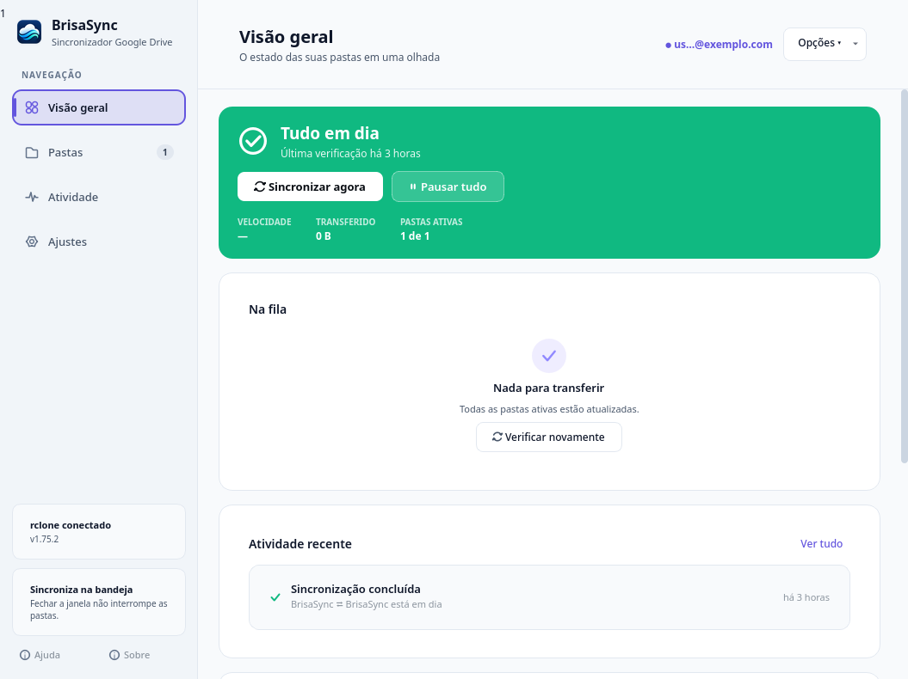
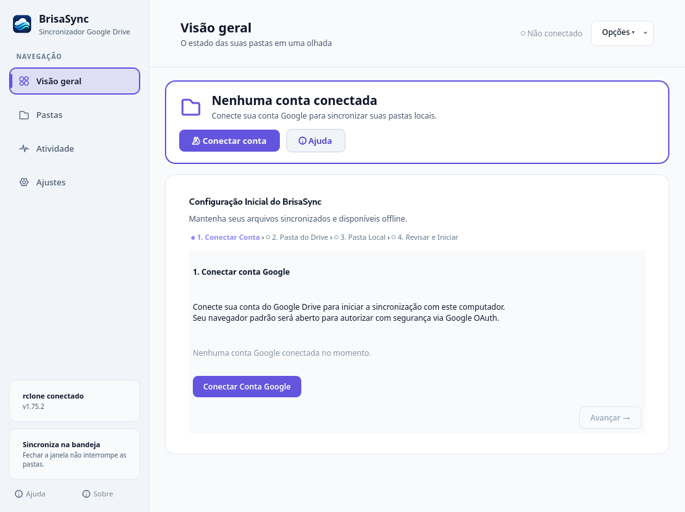

# BrisaSync (Português do Brasil)

[](https://github.com/fabio-agreles/BrisaSync/actions/workflows/ci.yml)
[](https://github.com/fabio-agreles/BrisaSync/actions/workflows/release.yml)
[](LICENSE)
[]()

**BrisaSync** (`brisasync`) é um aplicativo desktop de código aberto, moderno, nativo e seguro, projetado para sincronização bidirecional entre o **Google Drive** e **pastas locais** do usuário para acesso contínuo e offline.

Para a versão em inglês deste documento, consulte o [README.md](README.md).

> [!NOTE]
> **Aviso de Independência**: O BrisaSync é um projeto comunitário independente de código aberto e **não** é um produto oficial ou afiliado à Google LLC. "Google", "Google Drive" e marcas associadas são marcas comerciais registradas de propriedade da Google LLC.

<p align="center">
  
</p>

<details>
<summary><b>Visualizar Assistente Inicial (Sem Conta Conectada)</b></summary>
<p align="center">
  
</p>
</details>

---

## Destaques e Funcionalidades

- **Sincronização Bidirecional Fiel**: Alimentada pelo comando `rclone bisync` com conferência profunda de tamanho, timestamp e soma criptográfica (`--compare size,modtime,checksum`).
- **Salvaguarda Contra Exclusões em Massa**: Proteção dupla (percentual de 50% e limite absoluto explícito de 25 arquivos) antes de propagar deleções, sem nunca empregar `--force`.
- **Integridade Estrita de Baselines**: Sem execução cega de `--resync` para mascarar falhas; estados divergentes requerem resolução segura pelo usuário.
- **Isolamento de Credenciais em Cofre da Sessão**: Tokens OAuth, senhas e chaves criptográficas nunca são gravados em SQLite, arquivos planos de texto, argumentos de linha de comando ou arquivos de log. No Linux, integra-se ao Freedesktop Secret Service (GNOME Keyring) ou KDE Wallet; no Windows, utiliza nativamente o Windows Credential Manager (`Advapi32.dll`).
- **Integração com o Ambiente de Trabalho**:
  - **Linux**: Ícone na bandeja com estados semânticos em tempo real, suporte a Wayland e X11, inicialização oculta (`--start-hidden`), controle de instância única via IPC e serviço de sincronização em segundo plano via `systemd --user`.
  - **Windows**: Notificações nativas, autoinício pelo Registro do Windows (`HKCU Run`), persistência em `%APPDATA%` e instalador por usuário em `%LOCALAPPDATA%\Programs\BrisaSync`.
- **Interface Bilíngue**: Suporte completo e dinâmico a Português (Brasil) e English, alternável sem necessidade de reiniciar o daemon em segundo plano.
- **Apoio Voluntário via Pix**: Desenvolvimento sustentado de forma transparente por contribuições voluntárias da comunidade.

---

## Matriz de Suporte por Plataforma e Formato

| Plataforma / Formato | Status | Pacote / Distribuição | Observações |
| :--- | :---: | :--- | :--- |
| **Arch / Manjaro / BigLinux** | **Validado** | `brisasync-0.1.28-1-x86_64.pkg.tar.zst` | Pacote nativo com motor `rclone` embutido e serviço `systemd --user`. |
| **Debian / Ubuntu / Mint** | **Validado** | `brisasync_0.1.28-1_amd64.deb` | Pacote `.deb` padrão direcionado a Ubuntu 24.04+ e Debian 13+ com `python3-pyside6` nativo no APT. |
| **AppImage (Universal Linux)** | **Validado** | `BrisaSync-0.1.28-x86_64.AppImage` | Pacote verdadeiramente standalone com runtime Python, PySide6/Qt6 e `rclone` embutidos. |
| **Windows 10/11 x64** | **Validado** | `BrisaSync-0.1.28-Setup-x64.exe` e `.zip` | Instalador NSIS e pacote portátil com suporte ao Windows Credential Manager. |
| **Flatpak** | **Pendente** | `packaging/flatpak/org.brisasync.BrisaSync.yml` | Requer `--filesystem=home` e portal Background; pacote de dependências offline pendente. |

---

## Instalação e Utilização

### 1. Arch Linux / Manjaro / BigLinux (`.pkg.tar.zst`)

Baixe o pacote oficial nas [Releases](https://github.com/fabio-agreles/BrisaSync/releases) e instale via `pacman`:

```bash
sudo pacman -U brisasync-0.1.28-1-x86_64.pkg.tar.zst
```

Para atualizar uma instalação prévia:
```bash
systemctl --user stop brisasync.service || true
sudo pacman -U brisasync-0.1.28-1-x86_64.pkg.tar.zst
```

### 2. Debian / Ubuntu / Linux Mint (`.deb`)

> [!NOTE]
> O pacote `.deb` nativo destina-se a sistemas com `python3-pyside6` disponível nos repositórios oficiais APT (Ubuntu 24.04+ Noble e Debian 13+ Trixie). Para Debian 12 (Bookworm) e Ubuntu 22.04 LTS (Jammy), utilize o **AppImage Universal** abaixo.

```bash
sudo apt-get update
sudo apt-get install ./brisasync_0.1.28-1_amd64.deb
```

### 3. AppImage (Universal para Linux x86_64)

O AppImage é totalmente autocontido e incorpora seu próprio runtime Python, PySide6, plugins Qt6 e `rclone`:

```bash
chmod +x BrisaSync-0.1.28-x86_64.AppImage
./BrisaSync-0.1.28-x86_64.AppImage
```

### 4. Windows 10 e 11 (64 bits)

Baixe o executável `BrisaSync-0.1.28-Setup-x64.exe` e execute o instalador. A instalação é feita em nível de usuário em `%LOCALAPPDATA%\Programs\BrisaSync`, sem necessidade de privilégios de administrador.

> [!TIP]
> **Aviso do Windows SmartScreen**: Como um projeto de software livre independente sem certificado comercial corporativo EV, o filtro SmartScreen do Windows pode exibir um aviso de "Aplicativo não reconhecido" na primeira inicialização. Clique em **"Mais informações"** e em **"Executar assim mesmo"**. Você pode conferir os hashes no arquivo `SHA256SUMS.txt`.

---

## Google Drive OAuth e Privacidade

- **Cliente Desktop Público**: O BrisaSync inclui identificadores de cliente OAuth para desktop abertos para simplificar a conexão.
- **Chave Própria**: Caso prefira, você pode inserir seu próprio Client ID e Client Secret em **Ajustes → Contas**.
- **Status de Homologação**: O processo formal de verificação pública das telas de consentimento do Google está em andamento. Durante a fase de validação, novas contas podem visualizar a tela padrão "O Google não verificou este app", sendo possível prosseguir em modo de teste ou desenvolvedor.
- **Declaração de Privacidade**: A política de privacidade completa e pública está acessível em [https://brisasync.com.br/privacy/](https://brisasync.com.br/privacy/).

---

## Apoio Voluntário via Pix

O BrisaSync é gratuito e de código aberto. Se o aplicativo é útil para o seu fluxo diário, considere apoiar sua manutenção e evolução:

- **Beneficiário**: Fábio Agreles Bezerra
- **Chave Pix**: `e4bf0532-8016-42bf-bf2a-fd81326b6621`
- **E-mail de Contato**: `fabioagreles@gmail.com`
- **Website Oficial**: [https://brisasync.com.br/](https://brisasync.com.br/)

---

## Licença

O BrisaSync é distribuído sob os termos da [GNU General Public License v3.0 or later (GPL-3.0-or-later)](LICENSE).
Avisos e licenças de componentes de terceiros (como `rclone` e `PySide6`) estão documentados em [THIRD_PARTY_NOTICES.md](THIRD_PARTY_NOTICES.md).

