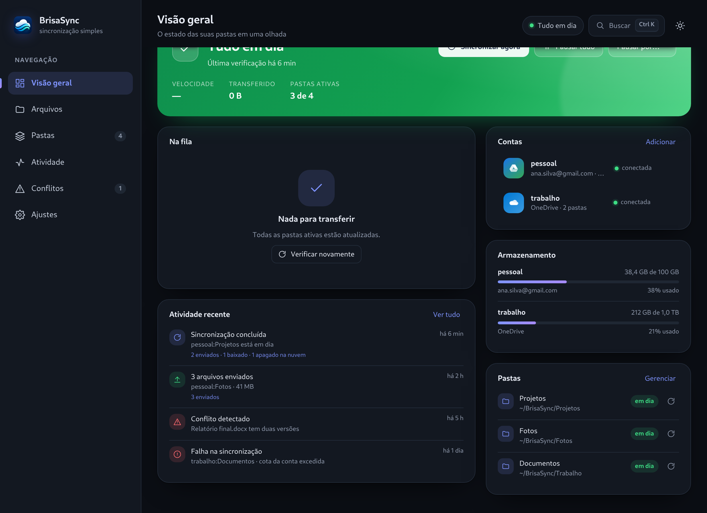

# BrisaSync

Sincronização bidirecional entre pastas deste computador e **Google Drive**, **OneDrive**, **Dropbox** ou **Nextcloud** — com visual cuidado e uso simples, em vez de um painel cheio de opções. Feito com [Tauri 2](https://tauri.app) (Rust + React) e o motor [bisync do rclone](https://rclone.org/bisync/) embutido nos pacotes.

**Português** · [English](README.md)

## O que ele faz

- **Bisync de verdade**: alterações locais e da nuvem descem e sobem sozinhas, sem sincronização em um sentido só.
- **Quatro provedores integrados**: conecte contas do **Google Drive**, **OneDrive**, **Dropbox** e **Nextcloud** no mesmo lugar, com opção de usar suas próprias credenciais OAuth do Google.
- **Detecção rápida na nuvem**: consulta leve às APIs de alterações do Google Drive e OneDrive a cada 30 segundos, evitando varreduras pesadas quando nada mudou.
- **Sincronização seletiva visual**: escolha quais subpastas da nuvem sincronizar ou ignorar em cada perfil sem editar filtros manualmente.
- **Navegador de arquivos com arrastar e soltar**: explore pastas remotas, baixe itens avulsos ou arraste múltiplos arquivos e pastas para enviar.
- **Conflitos lado a lado**: compare versões conflitantes, escolha qual fica e retome a sincronização imediatamente.
- **Trava de segurança**: se um dos lados ficar vazio e o outro não, a sincronização é barrada em vez de apagar o lado cheio.
- **Integração com o sistema**: bandeja com velocidade e progresso ao vivo, iniciar com o sistema, notificações nativas, limites de banda, regras de ignorar, tema claro/escuro, atualizador integrado e relatório de diagnóstico sem segredos.
- **Português e inglês**, trocados em Ajustes → Sistema → Idioma (sem reiniciar), sem telemetria: nada sai do computador além do tráfego direto para o provedor escolhido.
- **Doações opcionais via Pix** em Ajustes, para quem quiser ajudar a manter o projeto — com QR code e "copia e cola". Nada do app depende disso.

## Instalar

Baixe em [Releases](https://github.com/fabio-agreles/BrisaSync/releases/latest):

| Pacote | Para |
| --- | --- |
| `BrisaSync_x.y.z_amd64.deb` | Debian, Ubuntu, Mint — `sudo apt install ./*.deb` |
| `BrisaSync_x.y.z_amd64.AppImage` | Qualquer Linux, sem instalar (usa o WebKitGTK do sistema) |
| `BrisaSync-x.y.z-x86_64.flatpak` | Flatpak (`app.brisasync.BrisaSync`), isolado |
| `BrisaSync_x.y.z_x64-setup.exe` | Windows 10/11 (instalador NSIS, sem assinatura digital) |
| `BrisaSync-x.y.z-windows-x64.zip` | Windows 10/11 portátil, sem instalar |

O rclone vai dentro de todos os pacotes: não é preciso instalá-lo separadamente.

## Documentação

- [`app/README.md`](app/README.md) — arquitetura, como rodar do código, decisões de velocidade e limites conhecidos.
- [`app/flatpak/README.md`](app/flatpak/README.md) — build offline do Flatpak e detalhes do manifesto.
- [`PRIVACIDADE.md`](PRIVACIDADE.md) — política de privacidade.
- [`SECURITY.md`](SECURITY.md) — como relatar uma vulnerabilidade (nunca em issue pública) e o que esperar.

## Estado

Funciona em Linux (Flatpak, `.deb`, AppImage) e Windows. Limitações conhecidas: os pacotes não são assinados (o SmartScreen avisa no Windows), o AppImage não embute o WebKitGTK, e o projeto OAuth padrão do Google ainda não é verificado (teto de 100 contas — você pode usar suas próprias credenciais do Google Cloud em Ajustes → Avançado).

Licença: [MIT](LICENSE).
