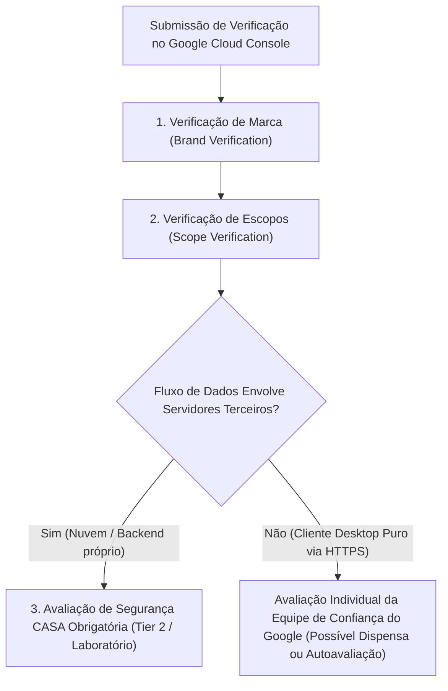

# Dossiê de Preparação do Google OAuth — BrisaSync

**Documento Técnico de Referência para Publicação e Verificação**  
**Versão Alvo**: BrisaSync v0.1.21 (Release Candidate)  
**Data da Consulta Oficial**: 4 de novembro de 2026  
**Fontes Oficiais Consultadas**:
- *Google API Services User Data Policy* ([https://developers.google.com/terms/api-services-user-data-policy](https://developers.google.com/terms/api-services-user-data-policy))
- *Google Cloud Console Help — OAuth API Verification* ([https://support.google.com/cloud/answer/9110914](https://support.google.com/cloud/answer/9110914))
- *Google Identity — Restricted Scopes Verification Requirements* ([https://developers.google.com/identity/protocols/oauth2/production-readiness/restricted-scope-verification](https://developers.google.com/identity/protocols/oauth2/production-readiness/restricted-scope-verification))
- *App Defense Alliance — Cloud Application Security Assessment (CASA)* ([https://appdefensealliance.dev/casa](https://appdefensealliance.dev/casa))

---

## 1. Configuração Atual do Cliente OAuth no BrisaSync

O BrisaSync implementa a especificação oficial do Google para **aplicativos nativos instalados em desktop** (*Native / Installed Desktop Application*), em estrita conformidade com a [RFC 8252 (OAuth 2.0 for Native Apps)](https://tools.ietf.org/html/rfc8252) e [RFC 7636 (PKCE)](https://tools.ietf.org/html/rfc7636).

### 1.1 Arquivo de Configuração e Identificadores
- **Arquivo de Configuração**: `src/brisasync/resources/oauth/google_oauth_client.json` (instalado em `/usr/share/brisasync/google_oauth_client.json`).
- **Tipo de Cliente no Google Cloud**: `installed` (Aplicativo Desktop / Desktop App).
- **Client ID**: `626522180431-g1rhfv809cgre8td1mkt2g1m67bbeknv.apps.googleusercontent.com`
- **Mecanismo de Desafio Criptográfico**: PKCE com `code_challenge_method=S256` gerado dinamicamente para cada fluxo de autenticação.
- **Redirecionamento**: Servidor HTTP local efêmero em loopback restrito à interface de loopback (`http://127.0.0.1:<porta>/callback`), com seleção dinâmica de porta livre do sistema operacional.

### 1.2 Escopos Solicitados pelo Aplicativo
Conforme implementado em [`src/brisasync/credentials/oauth_google.py`](file:///home/agreles/Aplicativos/BrisaSync/src/brisasync/credentials/oauth_google.py):

| Escopo | Classificação Google | Finalidade no BrisaSync |
| :--- | :--- | :--- |
| `https://www.googleapis.com/auth/drive` | **Restrito** (*Restricted*) | Leitura, gravação, sincronização bidirecional e listagem de arquivos e pastas no Google Drive do usuário. |
| `openid` | **Geral / Não Sensível** (*General / Non-sensitive*) | Identificação básica de autenticação OpenID Connect. |
| `https://www.googleapis.com/auth/userinfo.email` | **Geral / Não Sensível** (*General / Non-sensitive Profile*) | Obtenção do endereço de e-mail do usuário autenticado para exibição na interface e associação à conta local. |

---

## 2. Enquadramento e Requisitos Oficiais de Verificação do Google

A publicação do aplicativo para o público geral (mudança de status de *Testing* para *In Production*) no Google Cloud Console envolve três etapas regulatórias distintas:

### 2.1 Verificação de Marca (*Brand Verification*)
Aplicável quando o aplicativo solicita dados de usuários do Google e publica sua tela de consentimento externamente:
- **Dados Oficiais Definidos pelo Mantenedor**:
  - **Nome da Aplicação**: `BrisaSync`
  - **Domínio Oficial**: `brisasync.com.br`
  - **Página Inicial Planejada (Publicação Pendente)**: `https://brisasync.com.br/` *(hospedagem e DNS em configuração)*
  - **Política de Privacidade Planejada (Publicação Pendente)**: `https://brisasync.com.br/privacy/` *(disponibilização pública em andamento)*
  - **E-mail Público de Suporte ao Usuário**: `fabioagreles@gmail.com`
  - **Logotipo Oficial**: Ícone mestre de 120×120 px (formato PNG/JPEG com fundo limpo).
- **Domínio Verificado no Search Console**: O domínio `brisasync.com.br` que hospeda a Política de Privacidade e a página inicial deve ter sua propriedade comprovada no **Google Search Console** pela mesma conta mantenedora do projeto Google Cloud (`fabioagreles@gmail.com`).

### 2.2 Verificação de Escopos (*Scope Verification*)
Por utilizar o escopo `https://www.googleapis.com/auth/drive`, classificado como **Restrito**, a aplicação é submetida a um escrutínio rigoroso pela equipe de confiança e segurança (*Trust & Safety*) do Google:

1. **Caso de Uso Autorizado**:
   O Google define casos de uso aceitáveis para o escopo `drive` na *Google API Services User Data Policy*. O BrisaSync se enquadra nominalmente na categoria:
   > *"Backup and sync: Platform-specific apps that provide local sync or automatic backup of a user's Drive files."*
2. **Demonstração de Necessidade Estrita (Por que `drive.file` é tecnicamente insuficiente?)**:
   - O escopo reduzido `https://www.googleapis.com/auth/drive.file` concede acesso **apenas** a arquivos e pastas criados pelo próprio aplicativo ou abertos/compartilhados explicitamente pelo usuário através de um seletor visual interativo (como o Google Picker).
   - O BrisaSync é um utilitário de sincronização contínua de pastas que necessita descobrir pastas e estruturas preexistentes no "Meu Drive" (ex.: sincronizar a pasta existente "Documentos/Projetos" ou sincronizar bidirecionalmente arquivos criados ou modificados externamente na web pelo usuário).
   - Com `drive.file`, o motor de sincronização não possui permissão para enumerar pastas já existentes na raiz do Google Drive do usuário, tornando tecnicamente impossível a sincronização bidirecional de diretórios de trabalho previamente organizados na nuvem.
3. **Vídeo Demonstrativo Obrigatório (*Screencast*)**:
   - É mandatório fornecer um link de vídeo (geralmente via YouTube não-listado) demonstrando todo o fluxo da aplicação.

### 2.3 Enquadramento da Avaliação de Segurança (*Security Assessment / CASA*)
A *App Defense Alliance* e o Google operam o programa CASA (*Cloud Application Security Assessment*):
- **O que estabelece a documentação oficial**: A obrigatoriedade de auditoria externa de segurança (CASA Tier 2 realizado por laboratório homologado) incide primordialmente sobre aplicações que recebam, processem ou armazenem dados restritos através de **servidores de terceiros ou serviços em nuvem intermediários do desenvolvedor**.
- **Arquitetura Real do BrisaSync**: O BrisaSync é um cliente desktop que roda exclusivamente na estação de trabalho do usuário. As chamadas de API (OAuth e Google Drive) são realizadas diretamente entre o computador local e os servidores da Google via HTTPS, sem qualquer servidor proxy, banco de dados remoto ou backend intermediário.
- **Posicionamento para a Submissão**: Não se deve prometer dispensa automática nem assumir antecipadamente a obrigatoriedade de auditoria paga de laboratório. O mantenedor deve descrever com precisão no formulário de verificação que a arquitetura é 100% cliente desktop local (*client-side native app*), aguardando a decisão da equipe de segurança do Google quanto à dispensa formal ou eventual submissão de autoavaliação (CASA Tier 1 / Self-Assessment Questionnaire).

### 2.4 Limitação do Modo de Teste (*Testing Mode*)
Enquanto a verificação pública não for aprovada:
- Apenas até 100 usuários com e-mails explicitamente inseridos na lista de permissões do Google Cloud Console podem se autenticar.
- **Expiração a cada 7 dias**: Por política compulsória do Google para aplicações não verificadas em modo de teste, todos os *refresh tokens* gerados expiram em 7 dias, exigindo reautenticação semanal pelo usuário.

---

## 3. Textos para Submissão no Google Cloud Console

### 3.1 Informações Gerais da Aplicação

#### Dados de Formulário da Tela de Consentimento (Google Cloud Console)
- **App name (Nome do app)**: `BrisaSync`
- **User support email (E-mail de suporte ao usuário)**: `fabioagreles@gmail.com`
- **Application home page (Página inicial)**: `https://brisasync.com.br/` *(Publicação pendente)*
- **Application privacy policy link (Link da política de privacidade)**: `https://brisasync.com.br/privacy/` *(Publicação pendente)*
- **Authorized domains (Domínios autorizados)**: `brisasync.com.br`
- **Developer contact information (Dados de contato do desenvolvedor)**: `fabioagreles@gmail.com`

#### Descrição da Aplicação (Português)
> O BrisaSync é um utilitário desktop open source para Linux projetado para fornecer sincronização bidirecional e backup local entre pastas do usuário e o Google Drive. O aplicativo conecta o computador do usuário diretamente aos serviços da Google via HTTPS, permitindo o trabalho offline e mantendo arquivos sincronizados periodicamente sem intermediários ou servidores externos.

#### Application Description (English)
> BrisaSync is an open-source Linux desktop utility designed to provide reliable bidirectional synchronization and local backup between user folders and Google Drive. The application connects the user's machine directly to Google services over HTTPS, enabling seamless offline work and periodic file syncing without any third-party servers or intermediaries.

---

### 3.2 Justificativa de Uso do Escopo Restrito (`drive`)

#### Justificativa Técnica (Português)
> O BrisaSync é um aplicativo de sincronização local e backup (enquadrado na categoria "Backup and sync" das políticas de dados da Google). Ele requer o escopo `https://www.googleapis.com/auth/drive` para listar, descobrir e sincronizar pastas e arquivos preexistentes selecionados pelo usuário em sua conta do Google Drive com diretórios locais da máquina Linux.
> 
> O escopo mais restrito `drive.file` é tecnicamente inviável para esta finalidade, pois ele concede permissão exclusivamente para arquivos e pastas criados pelo próprio aplicativo ou abertos/compartilhados via Google Picker. O BrisaSync necessita sincronizar diretórios preexistentes no Meu Drive e detectar modificações feitas pelo usuário em outros dispositivos ou na interface web, o que requer capacidade de listagem e leitura/gravação da estrutura selecionada. Todas as operações ocorrem diretamente entre a máquina local e as APIs da Google via HTTPS, e nenhum dado de arquivo ou credencial trafega por servidores de terceiros.

#### Technical Justification (English)
> BrisaSync is a desktop local sync and backup tool falling strictly under Google's authorized "Backup and sync" category. It requires the `https://www.googleapis.com/auth/drive` scope to discover, enumerate, download, and synchronize user-selected pre-existing folders and files in Google Drive with local folders on a Linux workstation.
> 
> The narrower `drive.file` scope is technically insufficient because it only grants access to files and folders created by the app itself or explicitly opened/shared via a picker. BrisaSync needs to synchronize pre-existing directory hierarchies organized by the user in Google Drive and detect changes made externally on other devices or the web interface. All file transfers and API interactions occur directly between the local client and Google's official endpoints over HTTPS, with zero data routed through developer or third-party servers.

---

### 3.3 Justificativa dos Escopos de Identidade (`openid`, `userinfo.email`)

#### Justificativa (Português)
> Os escopos gerais `openid` e `https://www.googleapis.com/auth/userinfo.email` são utilizados unicamente para identificar o usuário autenticado na interface gráfica do BrisaSync, exibindo o endereço de e-mail da conta ativa e associando o chaveiro local à respectiva conta do Google Drive.

#### Justification (English)
> The general identity scopes `openid` and `https://www.googleapis.com/auth/userinfo.email` are used solely to identify the authenticated account within the BrisaSync desktop user interface, displaying the active user's email address and associating local credentials with the appropriate Google Drive account.

---

## 4. Roteiro para Gravação do Vídeo Demonstrativo (*Screencast Storyboard*)

O Google exige um vídeo demonstrativo claro e contínuo (sem cortes que ocultem a URL). O roteiro a seguir deve ser seguido rigorosamente na gravação:

1. **Cena 1 — Exibição do Desktop e Lançamento do BrisaSync**:
   - Abrir o terminal ou lançador e iniciar o BrisaSync.
   - Mostrar a tela inicial com o botão "Conectar conta Google".
2. **Cena 2 — Início do Fluxo OAuth e Redirecionamento ao Navegador**:
   - Clicar em "Conectar conta Google".
   - O navegador padrão é aberto automaticamente apontando para `https://accounts.google.com/o/oauth2/v2/auth`.
   - **Ponto Crítico Exigido pelo Google**: Fazer zoom ou manter visível e legível na barra de endereços do navegador o parâmetro `client_id=626522180431-g1rhfv809cgre8td1mkt2g1m67bbeknv.apps.googleusercontent.com`.
3. **Cena 3 — Tela de Consentimento e Concessão de Permissões**:
   - Selecionar a conta Google de teste.
   - Exibir a tela de consentimento detalhando o escopo do Google Drive solicitado.
   - Aceitar e confirmar a autorização.
   - O navegador redireciona para a página local de sucesso (`http://127.0.0.1:<porta>/callback`).
4. **Cena 4 — Retorno à Interface do BrisaSync e Configuração de Pasta**:
   - Mostrar o BrisaSync exibindo a conta conectada com sucesso (e-mail visível).
   - Selecionar uma pasta local vazia e vincular a uma pasta do Google Drive.
5. **Cena 5 — Demonstração da Sincronização em Ação**:
   - Iniciar a sincronização.
   - Criar um arquivo de teste na pasta local e demonstrar seu upload para o Google Drive na web.
   - Criar ou alterar um arquivo no Google Drive web e demonstrar o download para a pasta local no ciclo seguinte.
   - Enfatizar que a aplicação é puramente desktop e local.

---

## 5. Lista de Pendências Reais Dependentes do Mantenedor

Para submeter o BrisaSync à verificação no Google Cloud Console, as definições e etapas práticas seguem o status abaixo:

- [x] **1. Definição do Domínio e E-mail Oficial**:
  - Definido oficialmente pelo mantenedor: domínio `brisasync.com.br`, e-mail de suporte ao usuário `fabioagreles@gmail.com`, página inicial planejada `https://brisasync.com.br/` e política de privacidade planejada `https://brisasync.com.br/privacy/`.
- [ ] **2. Hospedagem e Configuração DNS / HTTPS**:
  - Configurar zona DNS (registros A/CNAME) para `brisasync.com.br` e provisionar certificado TLS/HTTPS para disponibilizar a página inicial (`https://brisasync.com.br/`) e a política (`https://brisasync.com.br/privacy/`).
- [ ] **3. Verificação de Propriedade no Google Search Console**:
  - Adicionar a propriedade de domínio `brisasync.com.br` no Search Console e validar a titularidade via registro DNS TXT utilizando a mesma conta mantenedora do projeto Google Cloud (`fabioagreles@gmail.com`).
- [ ] **4. Disponibilização Pública dos Conteúdos**:
  - Publicar a página da Política de Privacidade baseada em [`docs/PRIVACY_POLICY.md`](file:///home/agreles/Aplicativos/BrisaSync/docs/PRIVACY_POLICY.md) no caminho `https://brisasync.com.br/privacy/` e a landing page do projeto em `https://brisasync.com.br/`, confirmando que ambas estão acessíveis publicamente antes do envio ao Google.
- [ ] **5. Gravação e Envio do Screencast**:
  - Gravar o vídeo demonstrativo contínuo com o parâmetro `client_id` visível na URL do navegador durante o fluxo de login e demonstrar o funcionamento real da sincronização conforme o roteiro da Seção 4, publicando-o como "Não Listado" no YouTube para inserção no formulário do console.

